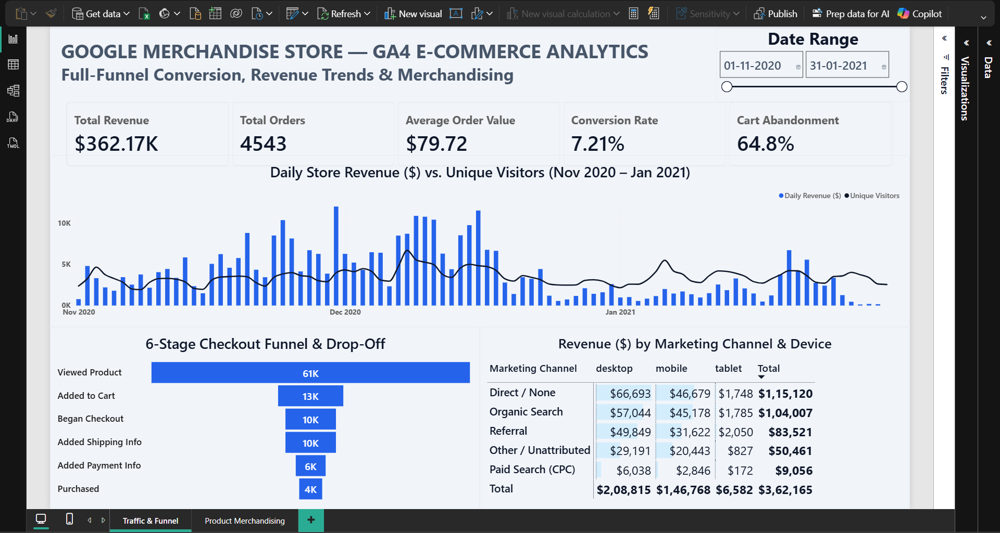
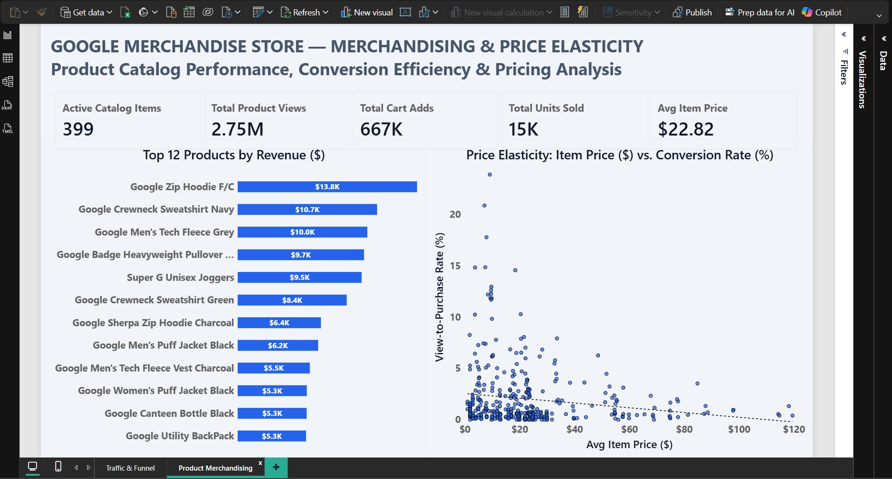

# 🛒 Google Merchandise Store — GA4 E-Commerce Funnel & Merchandising Analysis

### Google BigQuery (SQL) • Python • Pandas • Power BI • DAX

**Full-Funnel Checkout Progression • Multi-Channel Attribution • Catalog Price–Conversion Analysis**

## 📊 Dashboard

  

<b>📁 View all dashboard pages</b>

**Page 1 — Traffic & Funnel**

**Page 2 — Product Merchandising**

## 📌 Project Overview

This project investigates where shoppers drop off during checkout, which marketing channels and devices generate store sales, and how item pricing relates to product conversion across the Google Merchandise Store catalog.

Using the Google Analytics 4 (GA4) public BigQuery dataset, nested event logs were unnested and aggregated into grain-isolated tables for statistical validation and interactive Power BI reporting.

**GA4 BigQuery Raw Events → SQL Unnesting & Grain Isolation → Python / Pandas → Statistical Validation → Power BI → Interactive Dashboard**

## 🗂 Dataset

- **Source:** Google BigQuery public GA4 obfuscated sample e-commerce dataset.
- **Observation Period:** Store activity from 01-11-2020 to 31-01-2021.
- **Data Structure:** Daily event tables containing nested arrays for event parameters and item-level activity.
- **Reporting Tables:** Four aggregated tables covering funnel stages, daily traffic, channel-device performance, and product merchandising.

## 🎯 Business Questions

- **Checkout Friction:** Which stage of the buying journey experiences the steepest customer drop-off?
- **Channel & Device Split:** How do acquisition channels and device types compare in revenue generation?
- **Catalog Pricing:** How does item price relate to view-to-purchase conversion rates across active products?

## 📈 Key Insights

### Executive Store & Catalog Summary

| Metric Category | Metric Name | Value |
|---|---|---:|
| Revenue | Total Revenue | $362.17K |
| Transactions | Total Orders | 4,543 |
| Order Size | Average Order Value | $79.72 |
| Store Efficiency | Conversion Rate | 7.21% |
| Cart Friction | Cart Abandonment | 64.8% |
| Catalog Size | Active Catalog Items | 399 |
| Browsing Volume | Total Product Views | 2.75M |
| Cart Volume | Total Cart Adds | 667K |
| Unit Volume | Total Units Sold | 15K |
| Catalog Pricing | Average Item Price | $22.82 |

Daily revenue and visitor traffic rose across November, peaked during the December holiday shopping window, and moderated in January.

### Checkout Funnel Progression

| Funnel Stage | Users | Stage Transition Notes |
|---|---:|---|
| Viewed Product | 61K | Top-of-funnel product browsing |
| Added to Cart | 13K | Initial cart selection |
| Began Checkout | 10K | Checkout entry |
| Added Shipping Info | 10K | Full retention from checkout start |
| Added Payment Info | 6K | Primary checkout bottleneck |
| Purchased | 4K | Completed order conversion |

Shoppers who start checkout move smoothly through shipping details, whereas the step between shipping confirmation and payment submission represents the steepest checkout drop-off.

### Revenue by Marketing Channel & Device

| Marketing Channel | Desktop | Mobile | Tablet | Total |
|---|---:|---:|---:|---:|
| Direct / None | $66,693 | $46,679 | $1,748 | $115,120 |
| Organic Search | $57,044 | $45,178 | $1,785 | $104,007 |
| Other / Unattributed | $29,191 | $20,443 | $827 | $50,461 |
| Paid Search (CPC) | $6,038 | $2,846 | $172 | $9,056 |
| Referral | $49,849 | $31,622 | $2,050 | $83,521 |
| **Total** | **$208,815** | **$146,768** | **$6,582** | **$362,165** |

Direct and Organic Search lead store acquisition, and desktop sessions out-earn mobile and tablet traffic across every marketing channel.

### Top Revenue Products & Price–Conversion Analysis

| Product Name | Category | Revenue |
|---|---|---:|
| Google Zip Hoodie F/C | Outerwear | $13.8K |
| Google Crewneck Sweatshirt Navy | Fleece | $10.7K |
| Google Men's Tech Fleece Grey | Fleece | $10.0K |
| Google Badge Heavyweight Pullover Black | Pullover | $9.7K |
| Super G Unisex Joggers | Apparel | $9.5K |
| Google Crewneck Sweatshirt Green | Fleece | $8.4K |
| Google Sherpa Zip Hoodie Charcoal | Outerwear | $6.4K |
| Google Men's Puff Jacket Black | Jacket | $6.2K |
| Google Men's Tech Fleece Vest Charcoal | Vest | $5.5K |
| Google Women's Puff Jacket Black | Jacket & Gear | $5.3K |

Branded hoodies, sweatshirts, and jackets drive top product revenue, while the catalog-wide scatter plot and regression trend line show view-to-purchase conversion declining as item price increases.

## 💡 Potential Applications

- **Checkout Payment UX:** Add express payment options at the payment step to reduce drop-off after shipping entry.
- **Mobile Conversion Audit:** Streamline mobile product and checkout layouts to narrow the revenue gap with desktop users.
- **Merchandise Bundling:** Pair lower-priced accessories that convert at higher rates with flagship outerwear items.
- **Ad Spend Review:** Reassess paid search campaign targeting given its smaller revenue share compared to organic and referral traffic.

## ⚙️ Data Pipeline

### Data Exploration & Grain Isolation (SQL / BigQuery)

- Audited event schemas, date ranges, and nested item structures across GA4 tables.
- Built separate aggregated tables for funnel stages, daily traffic, channel-device attribution, and item-level performance.

📂 **View SQL scripts:**

- [01_data_exploration.sql](./sql/01_data_exploration.sql)
- [02_funnel_conversion_analysis.sql](./sql/02_funnel_conversion_analysis.sql)
- [03_traffic_and_acquisition.sql](./sql/03_traffic_and_acquisition.sql)
- [04_product_performance.sql](./sql/04_product_performance.sql)
- [05_transaction_analysis.sql](./sql/05_transaction_analysis.sql)

### Exploratory Analysis & Validation (Python / Pandas)

- Checked revenue distributions, traffic trends, and conversion ratios across exported datasets.
- Evaluated item-level price and conversion relationships prior to dashboard development.

📂 [View notebooks](./notebooks/)

### Dashboard Development (Power BI)

- Designed an interactive report covering Traffic & Funnel on the first page and Product Merchandising on the second page.
- Created DAX measures, conditional formatting data bars, regression trend lines, and a custom JSON theme.

📂 **View dashboard files:**

- [GA4_Merchandise_Store_Dashboard.pbix](./dashboard/GA4_Merchandise_Store_Dashboard.pbix)
- [ga4_clean_theme.json](./dashboard/ga4_clean_theme.json)

## 🛠 Tools & Skills Demonstrated

### Tools

- Google BigQuery (SQL)
- Python (Pandas, Matplotlib, Seaborn)
- Power BI Desktop & DAX
- Git & GitHub

### Skills

- GA4 Nested Schema Unnesting
- Multi-Grain Data Modeling
- Funnel & Attribution Analysis
- Price–Conversion Analysis
- Executive Dashboard Design

## 📋 Scope & Limitations

- **Obfuscated Fields:** The public GA4 sample dataset masks certain attribution values, which can appear under unattributed categories.
- **Limited Observation Period:** The analysis covers the sample period from November 2020 to January 2021 and should not be interpreted as current store performance.
- **Observational Pricing Analysis:** The relationship between item price and conversion is observational and does not, by itself, establish a causal pricing effect.
